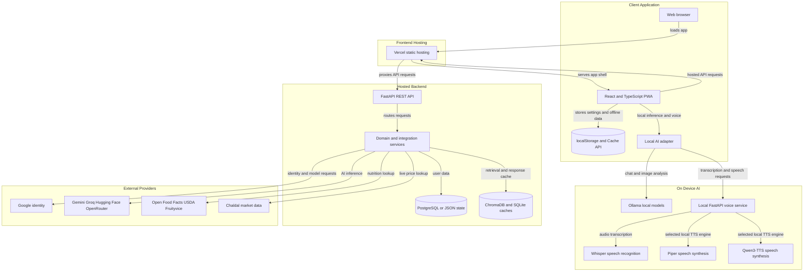
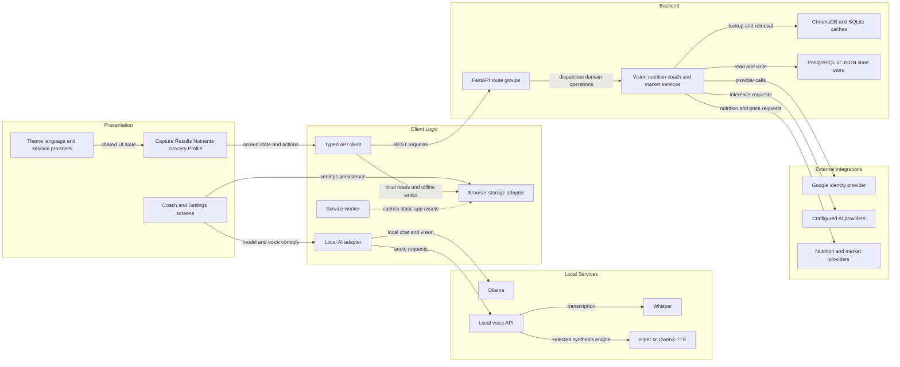

# Architecture Diagram

NutriVision AI is a React progressive web app with both device-local AI and an optional hosted FastAPI backend. Offline inference and voice services run as separate local processes; account-backed and provider-integrated operations use the hosted API when available.

## Application Architecture

<!-- mermaid-checked: no \n, no em-dash/en-dash, no {} in labels, subgraphs are id["label"], arrows are -->|"label"|, all subgraphs closed by end, ids unique -->

### Technology Stack Summary

| Layer | Technology | Version | Purpose |
|---|---|---|---|
| Client | React | 18.3 | Screen composition and interaction |
| Client | TypeScript | 5.6 | Typed application and API contracts |
| Build and hosting | Vite and Vercel | Vite 5.4; Vercel platform | PWA build and static hosting |
| Offline client | Service Worker and browser storage | Web platform | App shell caching and device-local data |
| Local model runtime | Ollama | Separately installed | Local text and vision inference |
| Local voice runtime | FastAPI, faster-whisper, Piper, Qwen3-TTS | Optional packages | Local speech recognition and synthesis |
| Hosted API | FastAPI and Uvicorn | FastAPI 0.110+; Uvicorn 0.27+ | REST endpoints and OpenAPI docs |
| Backend schemas | Pydantic | 2.6 to below 2.9 | Request and response validation |
| Backend persistence | PostgreSQL, JSON, ChromaDB, SQLite | PostgreSQL driver 3.1+; ChromaDB 0.5 | Account data, retrieval, and caches |

### Data Storage & External Services

The browser stores profile, meal, grocery, session, and local AI settings in namespaced `localStorage`; the service worker caches the installed app shell and static assets. The hosted backend persists account data in PostgreSQL when `DATABASE_URL` is configured, otherwise it uses its JSON state file. ChromaDB provides persistent retrieval and vision caches, while SQLite backs the TTL cache. Online integrations include Google token verification, configured AI providers, nutrition databases, and Chaldal price lookup. The standalone local voice service loads only model files configured on the device.

### Key Architectural Decisions

- The PWA's Ollama and voice adapters call loopback services directly, keeping local model inference and voice processing on-device.
- The typed API client uses browser-local fallbacks for offline workflows; hosted account synchronization is not implied by those local writes.
- Backend PostgreSQL initialization failures are reported as unhealthy rather than silently switching stores; JSON is the selected fallback only when no database URL is configured.

## Component Relationships

<!-- mermaid-checked: no \n, no em-dash/en-dash, no {} in labels, subgraphs are id["label"], arrows are -->|"label"|, all subgraphs closed by end, ids unique -->

### Component Inventory

| Component | Layer | Type | Responsibility |
|---|---|---|---|
| Capture, Results, Nutrients, Grocery, Profile screens | Presentation | React screens | Meal capture, review, nutrition, and device workflows |
| Coach and Settings screens | Presentation | React screens | Local chat, voice controls, model discovery, and preferences |
| Theme, language, and session providers | Presentation | React providers | Shared visual, localization, and identity state |
| Typed API client | Client Logic | TypeScript service | REST requests and local-first fallbacks |
| Local AI adapter | Client Logic | TypeScript service | Ollama discovery, chat, image inference, and local voice calls |
| Browser storage adapter | Client Logic | Storage service | Namespaced localStorage reads and writes |
| Service worker | Client Logic | PWA worker | App shell precaching and static asset caching |
| Ollama | Local Services | Model runtime | Local text and vision inference |
| Local voice API | Local Services | FastAPI service | Whisper transcription and selected TTS synthesis |
| FastAPI route groups | Backend | REST routers | Authentication, vision, nutrition, profile, meals, grocery, coach, and admin endpoints |
| Domain services | Backend | Python services | Provider orchestration, nutrition, vision, coach, and market logic |
| ChromaDB and SQLite caches | Backend | Persistence adapters | Semantic retrieval, vision results, and TTL cache |
| PostgreSQL or JSON state store | Backend | Persistence adapter | Account profile, meal, and grocery state |
| External providers | Integrations | HTTP APIs | Identity verification, AI inference, nutrition data, and market prices |
